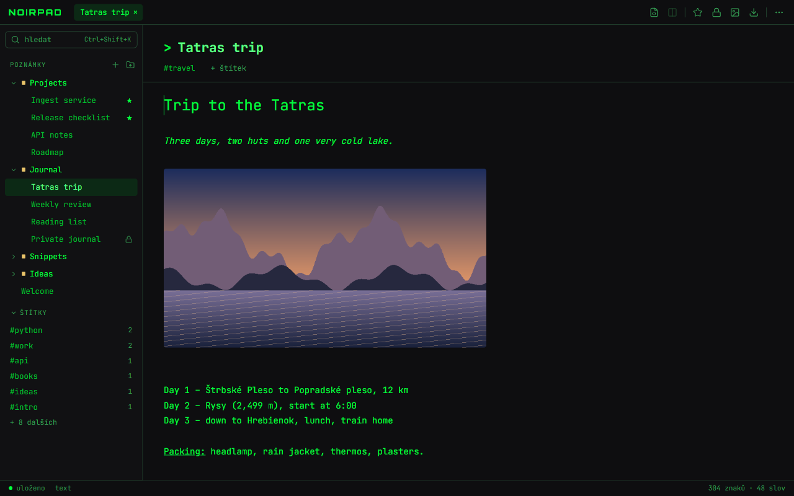

<div align="center">


# NoirPad

**Šifrované poznámky v Markdownu s duší terminálu — pro Windows.**

[English](README.md) · **Čeština**

[](https://github.com/krystof2-ops/NoirPad/releases/latest)
[](https://github.com/krystof2-ops/NoirPad/releases)
[](LICENSE)


<a href="https://github.com/krystof2-ops/NoirPad/releases/latest/download/NoirPad-Setup.exe"></a>

<sub>[Všechny verze](https://github.com/krystof2-ops/NoirPad/releases)</sub>


</div>

## Proč NoirPad?

- **Žádný účet, žádný cloud, žádná telemetrie** — poznámky jsou ve složce na vašem počítači
  a NoirPad sám nic po síti neposílá.
- **Šifrování jednotlivých poznámek** — každou poznámku můžete zamknout vlastním heslem.
- **Skutečný Markdown** — živý náhled vedle zdroje, tabulky, úkoly a zvýrazněný kód.
- **17 motivů** — od zelené Matrix po Tokyo Night, k tomu volitelná záře, CRT řádky a padající znaky.

## Funkce

### Rozhraní

- **Horní lišta** v jednom řádku: nápis NOIRPAD, karty otevřených poznámek a ikonová tlačítka -
  režim Markdown, náhled vedle zdroje, oblíbené, zámek, vložení obrázku, export a menu ⋯.
- **Levý panel**: nahoře hledání, sekce **POZNÁMKY** (strom složek; kontextové menu
  *Přejmenovat* / *Přesunout do…* / *Smazat*) a **ŠTÍTKY** (6 nejpoužívanějších a „+ N dalších";
  kliknutím na štítek filtrujete; kliknutím na nadpis sekci sbalíte - NoirPad si to pamatuje).
- **Hlavička poznámky**: přejmenování na místě, pod názvem štítky.
- Editor i náhled jsou bez rámečků. Zdroj Markdownu je obarvený: nadpisy, značky a kód v barvě
  akcentu, běžný text tlumeněji.
- **Stavový řádek**: ● uloženo / ○ neuloženo, režim, počty.

### Psaní



- Každá poznámka je **formátovaný text** nebo **Markdown** (`Ctrl+M`); otevřené poznámky jsou
  v záložkách, k dispozici je i režim soustředění.
- **Obrázky**: vložte, přetáhněte nebo přidejte tlačítkem; `Ctrl`+kolečko mění velikost obrázku
  v poznámce.
- Ukládání `Ctrl+S`, nebo zapněte automatické ukládání v Nastavení.
- Kontrola pravopisu je ve výchozím stavu zapnutá (Nastavení → Editor).

### Markdown a kód


- Vlevo zdroj, vpravo **živý náhled**.
- **Tabulky, úkoly, citace** a **bloky kódu se zvýrazněním syntaxe**.
- Zkratky pro tučné písmo, kurzívu, kód, bloky kódu a odkazy (`Ctrl+B`, `Ctrl+I`, `Ctrl+E`,
  `Ctrl+Shift+E`, `Ctrl+K`).

### Šifrování


- Poznámku zamknete `Ctrl+Shift+L`; otevře se jen s jejím heslem.
- Volitelný **zámek aplikace** chce heslo při spuštění NoirPadu nebo po nečinnosti.
- Co je a není šifrované: viz [Bezpečnost a soukromí](#bezpečnost-a-soukromí).

### Motivy


- **17 motivů**; nastavit jde i písmo rozhraní a editoru.
- **Noir efekty** - záře, Matrix déšť na pozadí, CRT řádkování a efekt „glitch" při psaní - jsou
  ve výchozím stavu **vypnuté**. Zapnete je v Nastavení → Noir efekty, jednotlivě nebo jedním
  přepínačem *Všechny Noir efekty*. Starší instalace si po upgradu ponechají dosavadní vzhled
  (záře zapnutá, déšť pokud jste ho nevypnuli).
- Rozhraní česky a anglicky; NoirPad začne v jazyce, který jste zvolili v instalátoru.

### Organizace


- **Složky** s přetahováním, **štítky**, **oblíbené** (připnuté nahoru ve své složce) a **koš**
  s obnovením.
- **Hledání** v poznámce (`Ctrl+F`) i ve všech poznámkách (`Ctrl+Shift+K`, pole *hledat* nahoře v levém panelu); **příkazová lišta** (`Ctrl+Shift+P`)
  spouští příkazy jako `:theme`, `:tag`, `:export`.
- Každou zkratku si můžete přenastavit.

### Export a zálohy

- Poznámku jako **TXT, HTML nebo PDF**; všechny poznámky jako soubory **Markdown** nebo stránky
  **HTML** v ZIPu. Desktopová aplikace se zeptá, kam uložit, a pak nabídne *Otevřít složku*.
- **Záloha**: jeden ZIP se všemi poznámkami a obrázky; *Importovat zálohu* ji obnoví.
- **Import** souborů Markdown nebo jejich ZIPu — poznámky přidá, žádné nesmaže.

## Klávesové zkratky

| Zkratka | Akce |
|---|---|
| `Ctrl+Shift+N` / `Ctrl+Shift+F` | Nová poznámka / nová složka |
| `Ctrl+S` | Uložit |
| `Ctrl+M` | Přepnout poznámku mezi formátovaným textem a Markdownem |
| `Ctrl+F`, `F3` / `Shift+F3` | Hledat v poznámce, další / předchozí výskyt |
| `Ctrl+Shift+K` | Hledat ve všech poznámkách |
| `Ctrl+Shift+L` | Zamknout nebo odemknout poznámku |
| `Ctrl+Shift+P` | Příkazová lišta |
| `Ctrl+D` | Přidat do oblíbených / odebrat |
| `F2` / `Delete` | Přejmenovat / přesunout do koše |
| `Ctrl+B` | Postranní panel (v editoru Markdownu: tučné písmo) |
| `Ctrl+Shift+V` / `Ctrl+Mezerník` | Vložit jako prostý text / vymazat formátování označeného textu |
| `Ctrl+Tab` / `Ctrl+W` | Další záložka / zavřít záložku |
| `Ctrl+,` / `F1` | Nastavení / nápověda |

Úplný seznam i s přenastavením najdete v Nastavení → Klávesové zkratky → Spravovat a v nápovědě
(`F1`).

## Instalace

1. Stáhněte **[NoirPad-Setup.exe](https://github.com/krystof2-ops/NoirPad/releases/latest/download/NoirPad-Setup.exe)**
   (nebo konkrétní verzi z [Releases](https://github.com/krystof2-ops/NoirPad/releases)).
2. Spusťte ho. Nainstaluje se jen pro vašeho uživatele — bez administrátorských práv — do
   `%LOCALAPPDATA%\Programs\NoirPad`.

**Windows SmartScreen:** instalátor není podepsaný, takže Windows může ukázat „Systém Windows
ochránil váš počítač". Klikněte na **Další informace → Přesto spustit**. Pro kontrolu souboru
porovnejte jeho SHA-256 se souborem `.sha256` vedle něj v release:

```powershell
Get-FileHash .\NoirPad-Setup.exe -Algorithm SHA256
```

NoirPad potřebuje Microsoft Edge **WebView2 Runtime**. Windows 11 ho mají; na Windows 10 nabídne
instalátor jeho stažení od Microsoftu.

**Vaše data** jsou v `%LOCALAPPDATA%\NoirPad` (vložte do adresního řádku Průzkumníka):
`notes_data.json` s poznámkami a nastavením, `images\`, `backups\` s automatickými zálohami
(posledních 7, nejvýš jedna za 10 minut) a `logs\` (spuštění a chyby, nikdy obsah poznámek).
Kdyby se datový soubor poškodil, NoirPad ho nechá stranou a obnoví nejnovější dobrou zálohu.

**Odinstalace** v Nastavení Windows → Aplikace. Programová složka se odstraní celá; poznámky
zůstanou, pokud nezvolíte, že se mají smazat taky.

## Bezpečnost a soukromí

**Zamčené poznámky** jsou šifrované Fernetem (AES-128-CBC + HMAC-SHA256); klíč vzniká z vašeho
hesla přes PBKDF2-SHA256 se 480 000 iteracemi a náhodnou solí pro každou poznámku. Heslo musí mít
aspoň 4 znaky; pod 8 znaků NoirPad upozorní, že krátké heslo jde snadno prolomit.

| Šifrované | Nešifrované |
|---|---|
| text poznámky | **název** poznámky, **štítky** a **složka** |
| | **obrázky** v poznámce (samostatné soubory v `images\`) |
| | údaje o formátování, oblíbené, nastavení |

- **Zapomenuté heslo k poznámce nejde obnovit.** Neexistuje reset ani zadní vrátka.
- Heslo se při odemčení jednou pošle místnímu serveru NoirPadu; po dobu otevření poznámky zůstává
  v paměti jen odvozený klíč. Na disk ani do logu se nikdy nezapisuje.
- **Zámek aplikace není šifrování.** Brání otevření NoirPadu, ale `notes_data.json` zůstává
  čitelný pro každého s přístupem k vašemu účtu ve Windows. Šifrované jsou jen zamčené poznámky.
  Zapomněli jste heslo k zámku aplikace? Zavřete NoirPad, smažte z `notes_data.json` položku
  `"app_lock": { … }` a NoirPad znovu spusťte — poznámek se to nedotkne.
- **Žádné síťové požadavky**: písma, vykreslování Markdownu i zvýrazňování kódu jsou součástí
  aplikace. Ven vedou jen odkazy, na které sami kliknete.

Bezpečnostní problémy hlaste prosím neveřejně, viz [SECURITY.md](SECURITY.md).

## Vlastní server

NoirPad běží i jako malý webový server (Python 3.14), třeba na domácím serveru:

```bash
git clone https://github.com/krystof2-ops/NoirPad.git
cd NoirPad
python -m venv .venv
.venv/bin/pip install -r requirements.txt        # Windows: .venv\Scripts\pip
NOIRPAD_PASSWORD='dlouhé heslo' NOIRPAD_ALLOWED_HOSTS=notes.example.org \
.venv/bin/python NoirPad-web.py                  # poslouchá na 127.0.0.1:8000
```

| Proměnná | Význam |
|---|---|
| `NOIRPAD_PASSWORD` | Heslo pro přihlášení. **Povinné**, pokud server neposlouchá jen na localhostu. |
| `NOIRPAD_ALLOWED_HOSTS` | Názvy hostitelů, na které server odpovídá (ochrana proti DNS rebindingu). |
| `NOIRPAD_HOST`, `NOIRPAD_PORT` | Adresa a port, výchozí `127.0.0.1:8000`. |
| `NOIRPAD_DATA_DIR` | Složka s daty, výchozí `~/.local/share/NoirPad` / `%LOCALAPPDATA%\NoirPad`. |
| `NOIRPAD_SECURE_COOKIES` | `1` za HTTPS (session cookie dostane příznak `Secure`). |

Nechte NoirPad na `127.0.0.1` a před něj dejte reverzní proxy s HTTPS (Caddy:
`notes.example.org { reverse_proxy 127.0.0.1:8000 }`), která předává původní hlavičku `Host`.

## Sestavení ze zdrojů

```powershell
powershell -ExecutionPolicy Bypass -File build.ps1    # testy → PyInstaller → Inno Setup
```

Požadavky a podrobnosti jsou v [BUILD.md](BUILD.md). Ze zdrojů: `python desktop.py` (okno) nebo
`python NoirPad-web.py` (prohlížeč na http://127.0.0.1:8000).

## Přispívání

Chyby a nápady pište do [Issues](https://github.com/krystof2-ops/NoirPad/issues). Před pull
requestem spusťte testy:

```bash
pip install -r requirements-dev.txt && python -m pytest -q    # backend
npm ci && npx vitest run                                       # frontend
```

Změny v jednotlivých verzích: [CHANGELOG.md](CHANGELOG.md).

## Licence

MIT — viz [LICENSE](LICENSE).
