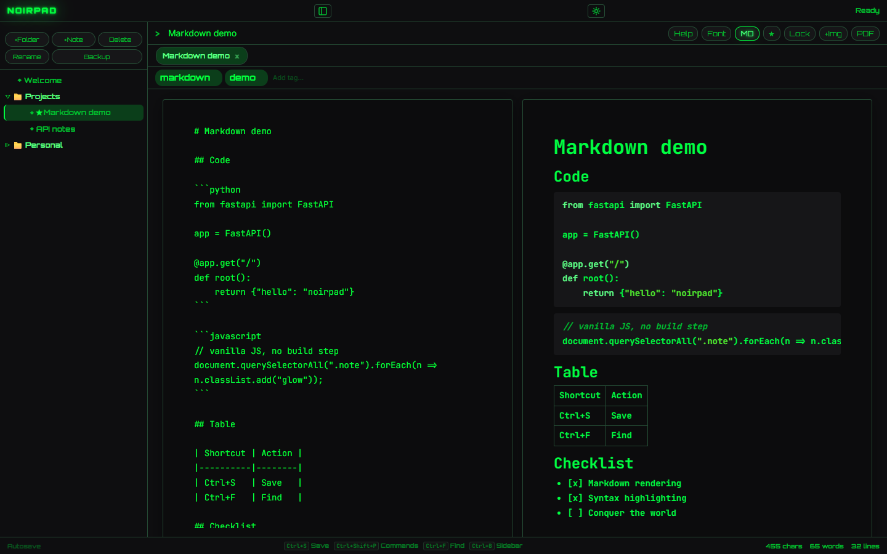
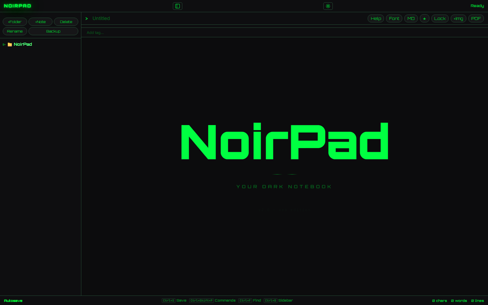

[English](README.md) | **Čeština**

<p align="center"></p>

# NoirPad

Poznámková aplikace pro Windows v terminálovém stylu – s Markdownem, poznámkami zamčenými heslem a 17 motivy.

[](https://github.com/krystof2-ops/NoirPad-web/releases)
[](https://github.com/krystof2-ops/NoirPad-web/actions/workflows/test.yml)
[](LICENSE)



**Žádný účet, žádný cloud, žádná telemetrie – vaše poznámky zůstávají ve vašem PC.**
NoirPad sám nic po síti neposílá: písma, vykreslování Markdownu i zvýrazňování kódu jsou součástí
aplikace. Ven vedou jen odkazy, na které sami kliknete.

| Úvod | Motivy | Zamčená poznámka |
|:---:|:---:|:---:|
|  |  |  |

## Funkce

- **Poznámky a složky** – strom s přetahováním, karty, štítky, oblíbené, koš s obnovou.
- **Dva režimy pro každou poznámku** – formátovaný text, nebo Markdown s živým náhledem, tabulkami, seznamy úkolů
  a zvýrazněnými bloky kódu.
- **Zamčené poznámky** – šifrování jednotlivé poznámky vlastním heslem (podrobnosti níže).
- **Zámek aplikace** (volitelně) – heslo při každém spuštění a po nečinnosti.
- **Hledání** – v poznámce, napříč všemi poznámkami, příkazová lišta (`Ctrl+Shift+P`).
- **Obrázky** – vložení ze schránky, přetažením nebo tlačítkem; zoom přes `Ctrl`+kolečko.
- **Export** – poznámka jako TXT, HTML nebo PDF; vše jako soubory Markdown nebo HTML v ZIPu.
- **Import** – soubory Markdown nebo jejich ZIP (poznámky přidá, nic nemaže).
- **Vzhled** – 17 motivů, písmo rozhraní i editoru, záře, CRT řádkování, Matrix rain, režim soustředění.
- **Klávesnice na prvním místě** – každou zkratku jde přemapovat; nápověda přes `F1`.
- **Čeština a angličtina** – podle jazyka systému, přepnout jde v Nastavení.

## Stažení

Stáhněte **`NoirPad-Setup-<verze>.exe`** z **[Releases](https://github.com/krystof2-ops/NoirPad-web/releases)**.
Instaluje se jen pro vašeho uživatele (bez práv správce) do `%LOCALAPPDATA%\Programs\NoirPad`.

NoirPad potřebuje **Microsoft Edge WebView2 Runtime**. Windows 11 ho mají; na starších systémech
instalátor nabídne jeho stažení od Microsoftu.

**Windows SmartScreen:** instalátor není digitálně podepsaný, takže Windows může ukázat „Systém
Windows ochránil váš počítač“. Klikněte na **Další informace → Přesto spustit**. Abyste měli jistotu,
že jde o soubor zveřejněný tady, porovnejte jeho SHA-256 se souborem `.sha256` vedle něj v release:

```powershell
Get-FileHash .\NoirPad-Setup-1.0.0.exe -Algorithm SHA256
```

## Vaše data

| Co | Kde |
|---|---|
| Poznámky, nastavení | `%LOCALAPPDATA%\NoirPad\notes_data.json` |
| Obrázky | `%LOCALAPPDATA%\NoirPad\images\` |
| Automatické zálohy | `%LOCALAPPDATA%\NoirPad\backups\` – posledních 7, nejvýš jedna za 10 minut, a kopie před každým importem zálohy |
| Log | `%LOCALAPPDATA%\NoirPad\logs\noirpad.log` – spuštění a chyby, nikdy obsah poznámek |

Složku otevřete vložením `%LOCALAPPDATA%\NoirPad` do adresního řádku Průzkumníka. Odinstalace se
zeptá, jestli ji smazat taky (výchozí volba: nechat).

- **Záloha:** Nastavení → Data → *Stáhnout zálohu* uloží ZIP se všemi poznámkami a obrázky.
  *Importovat zálohu* všechny poznámky **nahradí** obsahem ZIPu (předtím se uloží bezpečnostní kopie).
- **Export:** *Exportovat vše do Markdownu* vytvoří jeden soubor `.md` pro každou poznámku (složky
  jsou adresáře, obrázky ve složce `assets/`); *Exportovat vše do HTML* totéž jako čitelné stránky.
  Zamčené poznámky se přeskočí – aplikace řekne kolik.
- Kdyby se `notes_data.json` poškodil, NoirPad poškozený soubor nechá stranou, obnoví nejnovější
  dobrou zálohu a dá vám vědět.

## Šifrování a zámek aplikace

**Zamčené poznámky** (tlačítko Zamknout / `Ctrl+Shift+L`) jsou šifrované vaším heslem:
Fernet (AES-128-CBC + HMAC-SHA256) s klíčem z PBKDF2-SHA256, 480 000 iterací a náhodnou solí pro
každou poznámku.

| Šifrované | Nešifrované |
|---|---|
| text poznámky | **název** poznámky, její **štítky** a **složka** |
| | **obrázky** v poznámce (samostatné soubory v `images\`) |
| | údaje o formátování, oblíbené, nastavení |

- **Zapomenuté heslo k poznámce nejde obnovit.** Neexistuje reset ani zadní vrátka; poznámka
  zůstane nečitelná.
- Heslo se při odemčení jednou pošle místnímu serveru NoirPadu; ten si po dobu otevření poznámky
  drží v paměti jen odvozený klíč a zapomene ho při zamčení, po nečinnosti nebo při ukončení.
  Na disk ani do logu se nikdy nezapisuje.

**Zámek aplikace není šifrování.** Brání otevření NoirPadu (místní server odmítá všechny požadavky,
dokud ho neodemknete), ale `notes_data.json` zůstává čitelný pro každého, kdo má přístup k vašemu
účtu ve Windows. Šifrované jsou jen zamčené poznámky.

*Zapomněli jste heslo k zámku aplikace?* Zavřete NoirPad, otevřete
`%LOCALAPPDATA%\NoirPad\notes_data.json` v textovém editoru, smažte položku `"app_lock": { … }`
(pozor na čárky, aby JSON zůstal platný), uložte a spusťte NoirPad. Poznámek se to nedotkne.

## Vlastní server (webová verze)

NoirPad běží i jako malý webový server, třeba na domácím serveru. Potřebujete Python 3.14.

```bash
git clone https://github.com/krystof2-ops/NoirPad-web.git
cd NoirPad-web
python -m venv .venv
.venv/bin/pip install -r requirements.txt        # Windows: .venv\Scripts\pip
NOIRPAD_PASSWORD='dlouhá přístupová fráze' \
NOIRPAD_ALLOWED_HOSTS=poznamky.example.org \
NOIRPAD_HOST=127.0.0.1 NOIRPAD_PORT=8000 \
.venv/bin/python NoirPad-web.py
```

| Proměnná | Význam |
|---|---|
| `NOIRPAD_PASSWORD` | Heslo pro přihlášení. **Povinné**, když server poslouchá jinde než na localhostu (jinak se odmítne spustit). |
| `NOIRPAD_ALLOWED_HOSTS` | Čárkou oddělené názvy hostitelů, na které server odpovídá (ochrana proti DNS rebindingu). Localhost je povolený vždy. |
| `NOIRPAD_HOST`, `NOIRPAD_PORT` | Adresa a port, výchozí `127.0.0.1:8000`. |
| `NOIRPAD_DATA_DIR` | Datová složka, výchozí `~/.local/share/NoirPad` (Linux) / `%LOCALAPPDATA%\NoirPad`. |
| `NOIRPAD_SECURE_COOKIES` | `1` za HTTPS: session cookie dostane příznak `Secure`. |

**Používejte HTTPS.** Nechte NoirPad na `127.0.0.1` a před něj dejte reverse proxy (Caddy, nginx,
Traefik), která ukončí TLS a předá původní hlavičku `Host`. S Caddy:

```
poznamky.example.org {
    reverse_proxy 127.0.0.1:8000
}
```

Funguje i `uvicorn noirpad.app:app`, ale `NoirPad-web.py` navíc hlídá heslo podle tabulky výše
a to, aby datovou složku používal vždy jen jeden NoirPad.

## Sestavení ze zdrojáků, testy, licence

Build pro Windows (testy → PyInstaller → Inno Setup, z čistého checkoutu):

```powershell
powershell -ExecutionPolicy Bypass -File build.ps1
```

Požadavky a podrobnosti jsou v [BUILD.md](BUILD.md). Spuštění ze zdrojáků:
`python desktop.py` (okno) nebo `python NoirPad-web.py` (prohlížeč na http://127.0.0.1:8000).

Testy:

```bash
pip install -r requirements-dev.txt && python -m pytest -q    # backend
npm ci && npx vitest run                                       # frontend
```

Bezpečnostní chyby: viz [SECURITY.md](SECURITY.md). Změny: [CHANGELOG.md](CHANGELOG.md).

Licence MIT – viz [LICENSE](LICENSE).
