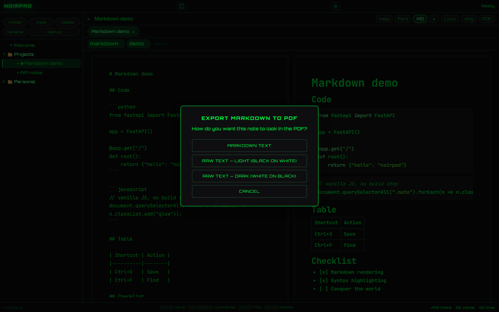
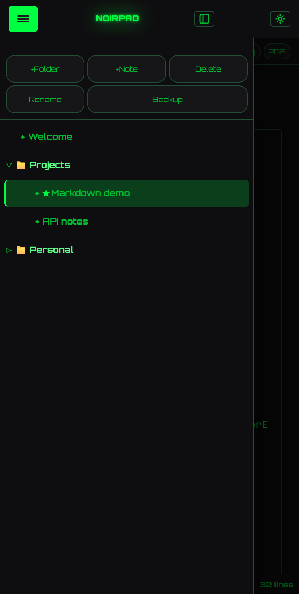

[English](README.md) | **Čeština**

# 🌃 NoirPad

> Note-taking aplikace v hacker/terminal estetice — Markdown, syntax highlighting, šifrování a 17 témat. FastAPI backend + vanilla JS frontend, bez build kroku.

[](https://www.python.org/)
[](https://fastapi.tiangolo.com/)
[](LICENSE)
[](https://github.com/krystof2-ops/NoirPad-web/releases)

NoirPad je lokální single-user desktop-style aplikace pro psaní poznámek inspirovaná estetikou terminálu. Spojuje čistý FastAPI backend s vanilla-JS frontendem (žádný build krok), takže ji naklonuješ, nainstaluješ a spustíš pod minutu. Poznámky žijí v jednom JSON souboru vedle aplikace — žádná databáze, žádný cloud, žádná telemetrie.

## 📸 Screenshoty

| Welcome Screen | Markdown + Syntax Highlighting |
|:---:|:---:|
|  |  |

| Témata | Šifrování |
|:---:|:---:|
|  |  |

| PDF Export | Mobilní layout |
|:---:|:---:|
|  |  |

## ✨ Funkce

### 📁 Poznámky a struktura
- Hierarchické folders + notes s drag & drop
- Multi-tab editor (víc otevřených poznámek)
- Per-note režim: rich-text nebo markdown
- Auto-save (interval 5s / 30s / 1m / 5m)

### ✍️ Markdown
- Split-pane editor — raw source vlevo, rendered preview vpravo
- Block-level rendering: H1-H3, blockquotes, listy, code blocks
- **Shiki syntax highlighting** s automatickou detekcí jazyka
- Markdown klávesové zkratky (toggle přes `Ctrl+M`)

### 🔒 Šifrování
- Per-note password encryption (Fernet + PBKDF2HMAC)
- Default-encrypted volba pro nové poznámky
- Auto-lock po nečinnosti (5 / 30 / 60 min)

### 🏷️ Organizace
- Tagy (multi-tag per poznámka)
- Favorites (hvězdičkování)
- Trash (soft-delete + restore)

### 🔍 Vyhledávání
- In-note find & replace (`Ctrl+F`)
- Globální fulltext search napříč poznámkami
- Command bar (`Ctrl+Shift+P`) s fuzzy searchem

### 📤 Export / Import
- Per-note: TXT, HTML, PDF (přes browser print)
- Celá aplikace: ZIP backup (data + obrázky)

### 🖼️ Obrázky
- Paste / drag-drop / `+Img` tlačítko
- `Ctrl`+wheel resize inline

### 🎨 Vzhled
- **17 témat**: matrix, amber, cyan, red, purple, blue, pink, white, gold, lime, orange, ice, dracula, synthwave, nord, gruvbox, tokyo-night
- UI font: Orbitron, Space Grotesk, Outfit, Unbounded, Inter, JetBrains Mono, system
- Volba editor fontu + velikosti
- Glow intensity slider (0-150 %)
- CRT scanline overlay (toggle)
- Matrix rain background (toggle)
- Glitch typing effect (toggle)
- ASCII splash screen (toggle)
- Orientace stránky: portrait / landscape

### ⌨️ UX a zkratky
- Customizable klávesové zkratky (rebinding libovolné akce)
- Built-in nápověda (`F1`)
- Focus mode (`Ctrl+B` — skryje sidebar)
- Spellcheck toggle
- Confirm-before-delete volba

### 📱 Mobilní layout
- Responsive (≤ 900px breakpoint)
- Slide-out sidebar s hamburgerem
- Touch-friendly tap targets

## 🛠️ Tech Stack

- **Backend:** Python 3.9+ — FastAPI, Uvicorn, Pydantic, cryptography, python-multipart
- **Frontend:** Vanilla JavaScript (33 modulů, žádný build, `window.NP` namespace), HTML, CSS
- **Storage:** Flat-file JSON (`notes_data.json`) — žádná databáze
- **Šifrování:** Fernet (AES-128-CBC + HMAC-SHA256) s PBKDF2HMAC odvozením klíče
- **Syntax highlighting:** Shiki (přes CDN) + `vscode-languagedetection`

## 📦 Instalace

```bash
# 1. Naklonuj repo
git clone https://github.com/krystof2-ops/NoirPad-web.git
cd NoirPad-web

# 2. (Doporučeno) Vytvoř virtual environment
python -m venv .venv
source .venv/bin/activate          # Linux / macOS
.venv\Scripts\activate             # Windows

# 3. Nainstaluj závislosti
pip install -r requirements.txt
```

## 🚀 Použití

```bash
# Standalone — preferováno pro běžné použití
python NoirPad-web.py

# Vývoj — s auto-reloadem při změně souborů
python -m uvicorn NoirPad-web:app --reload --host 127.0.0.1 --port 8000
```

Pak otevři **http://127.0.0.1:8000** v prohlížeči.

> Server poslouchá jen na `127.0.0.1` (loopback) záměrně — NoirPad je single-user lokální aplikace bez autentizace. Viz [Bezpečnost](#-bezpečnost).

## 📂 Struktura projektu

```
NoirPad-web/
├── NoirPad-web.py          # FastAPI backend (jeden soubor)
├── requirements.txt
├── notes_data.json         # Tvoje poznámky (vznikne při prvním spuštění)
├── images/                 # Embedované obrázky (UUID jména)
└── static/
    ├── index.html          # Single-page UI
    ├── css/
    │   ├── noirpad.css     # Hlavní stylesheet
    │   └── themes.css      # 17 theme color tokens
    └── js/                 # 33 frontend modulů
        ├── app.js          # bootstrap
        ├── api.js          # HTTP klient
        ├── editor.js       # rich-text editor
        ├── markdown.js     # split-pane preview
        ├── encryption.js   # password prompt UI
        └── ...             # (dalších 28)
```

## ⌨️ Klávesové zkratky

| Zkratka | Akce |
|---|---|
| `Ctrl+S` | Uložit aktuální poznámku |
| `Ctrl+F` | Hledat / nahradit v poznámce |
| `Ctrl+M` | Toggle Markdown mód |
| `Ctrl+B` | Focus mód (skryje sidebar) |
| `Ctrl+P` | Export aktuální poznámky do PDF |
| `Ctrl+Shift+P` | Command palette |
| `F1` | Otevřít nápovědu |
| `Escape` | Zavřít dialog / cancel |

Všechny zkratky lze přizpůsobit v **Settings → Keyboard shortcuts**.

## 🔐 Bezpečnost

NoirPad je navržen jako **lokální single-user desktop-style aplikace**:

- Server poslouchá jen na **127.0.0.1** (localhost) — není dostupný z jiných strojů v síti.
- **Žádná autentizace.** Kdokoli s přístupem ke tvému stroji má přístup k poznámkám.
- Pro citlivý obsah použij **per-note password encryption** (Lock tlačítko nebo `default_encrypted` nastavení). Šifrované poznámky používají Fernet (AES-128-CBC + HMAC-SHA256) s PBKDF2HMAC odvozením klíče; server tvoje heslo nikdy neukládá.
- **Co šifrované NENÍ:** šifruje se jen text poznámky. **Název, tagy a obrázky** (soubory ve složce `images/`) zůstávají na disku nešifrované.
- **Zapomenuté heslo nejde obnovit.** Poznámku už nikdy neotevřeš.
- Heslo jde do lokálního backendu jen jednou, při zamčení nebo odemčení. Backend drží odvozený klíč jen v paměti a zapomene ho, když poznámku opustíš, při auto-locku nebo při ukončení NoirPadu; na disk se nikdy nezapisuje.
- Auto-lock lze zapnout — po 5 / 30 / 60 minutách nečinnosti se heslo opět vyžádá.
- File-level safety: atomické writes přes `.tmp` swap, automatický `.bak` snapshot před každým write, recovery z backupu pokud je data soubor corrupt.
- Limity uploadu: obrázky 10 MB, backup ZIPy 100 MB. Path-traversal a zip-slip ochrana je aplikována na každý upload.

> Pokud chceš NoirPad vystavit na síti, **musíš** nejdřív přidat autentizaci.

## 🤝 Contributing

Pull requesty jsou vítané. Pro větší změny prosím nejdřív otevři issue a probereme, co bys chtěl změnit.

Při přispívání:
1. Zachovej no-build, no-bundle filosofii (vanilla JS, single Python soubor).
2. Drž se existujícího stylu kódu (žádný framework, plain DOM APIs, `window.NP.*` namespacing).
3. Otestuj na `matrix`, `dracula` a `tokyo-night` tématech — procvičí různé color systémy.

## 📜 Licence

[MIT](LICENSE) © 2025 krystof2-ops
