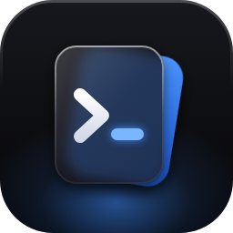
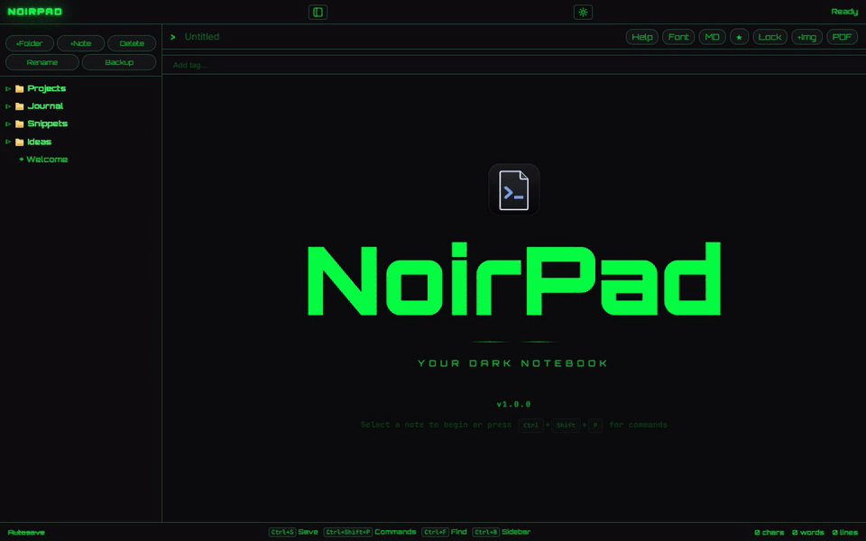
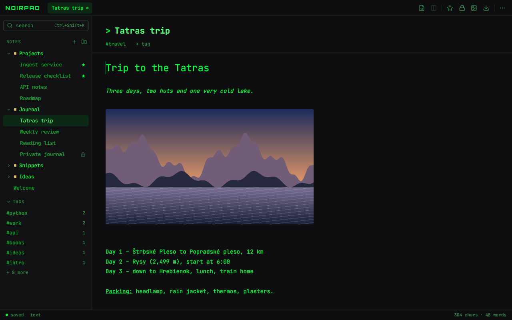
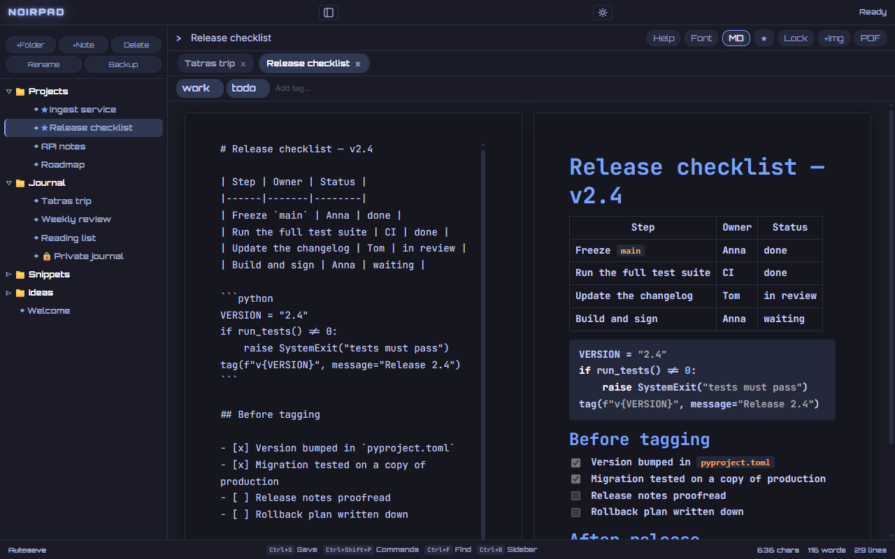
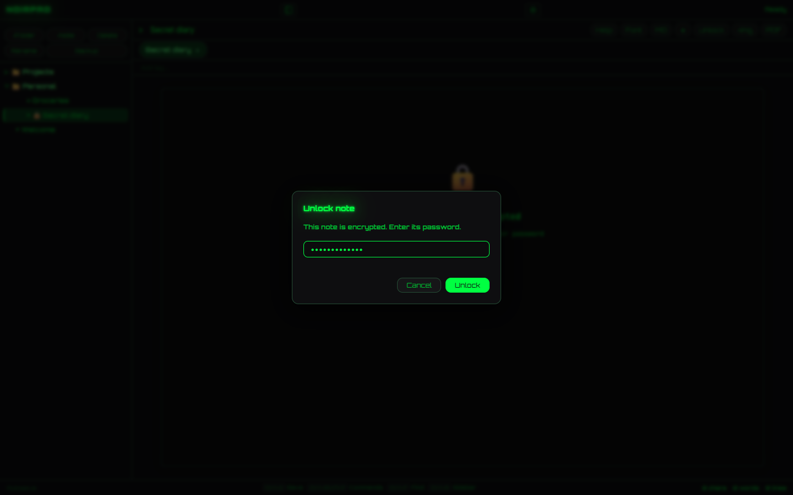
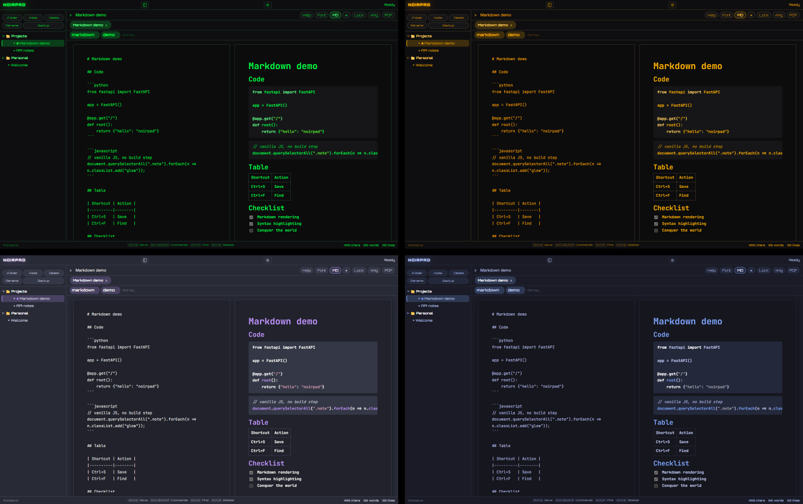
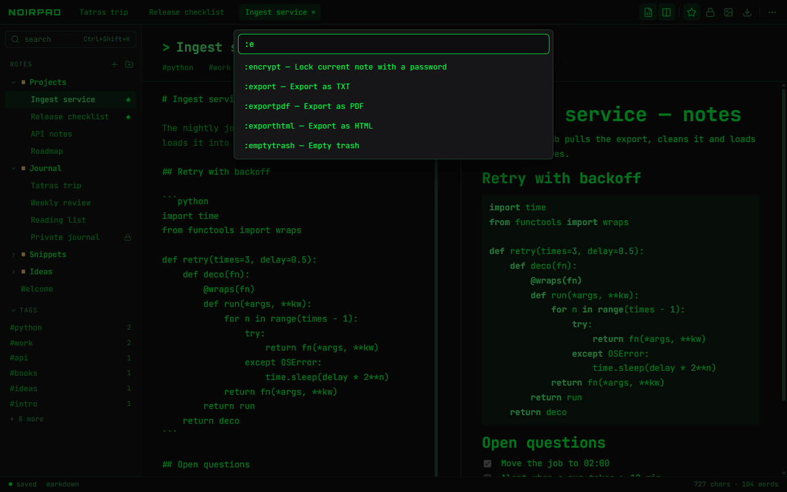

<div align="center">



# NoirPad

**Encrypted markdown notes with a terminal soul — for Windows.**

**English** · [Čeština](README.cs.md)

[](https://github.com/krystof2-ops/NoirPad/releases/latest)
[](https://github.com/krystof2-ops/NoirPad/releases)
[](LICENSE)


<a href="https://github.com/krystof2-ops/NoirPad/releases/latest/download/NoirPad-Setup.exe"></a>

<sub>[All releases](https://github.com/krystof2-ops/NoirPad/releases)</sub>



</div>

## Why NoirPad?

- **No account, no cloud, no telemetry** — notes live in a folder on your PC and NoirPad makes no
  network requests of its own.
- **Per-note encryption** — lock any note with its own password.
- **Real Markdown** — live side-by-side preview, tables, task lists and syntax-highlighted code.
- **17 themes** — from Matrix green to Tokyo Night, plus glow, CRT scanlines and Matrix rain.

## Features

### Writing



- Each note is **rich text** or **Markdown** (`Ctrl+M`), with tabs for open notes and a focus mode.
- **Images**: paste, drag & drop or insert them; `Ctrl`+wheel resizes an image in the note.
- Save with `Ctrl+S`, or turn on autosave in Settings.

### Markdown & code



- Source on the left, **live preview** on the right.
- **Tables, task lists, quotes** and fenced **code blocks with syntax highlighting**.
- Shortcuts for bold, italic, inline code, code blocks and links (`Ctrl+B`, `Ctrl+I`, `Ctrl+E`,
  `Ctrl+Shift+E`, `Ctrl+K`).

### Encryption



- Lock a note with `Ctrl+Shift+L`; it opens only with its password.
- Optional **app lock** asks for a password when NoirPad starts or after inactivity.
- What is and isn't encrypted: see [Security & privacy](#security--privacy).

### Themes



- **17 themes**; UI and editor fonts are configurable too.
- Glow intensity, CRT scanlines and Matrix rain — each can be switched off.
- English and Czech UI; NoirPad starts in the language you chose in the installer.

### Organize



- **Folders** with drag & drop, **tags**, **favorites** (pinned to the top of their folder) and a
  **trash** with restore.
- **Find** in the note (`Ctrl+F`) or across all notes; the **command bar** (`Ctrl+Shift+P`)
  runs commands like `:theme`, `:tag`, `:export`.
- Every shortcut can be remapped in Settings.

### Export & backup

- A note as **TXT, HTML or PDF**; all notes as **Markdown** files or **HTML** pages in a ZIP.
  The desktop app asks where to save and then offers *Open folder*.
- **Backup**: one ZIP with all notes and images; *Import backup* restores it.
- **Import** Markdown files or a ZIP of them — adds notes, never deletes any.

## Keyboard shortcuts

| Shortcut | Action |
|---|---|
| `Ctrl+Shift+N` / `Ctrl+Shift+F` | New note / new folder |
| `Ctrl+S` | Save |
| `Ctrl+M` | Switch the note between rich text and Markdown |
| `Ctrl+F`, `F3` / `Shift+F3` | Find in the note, next / previous match |
| `Ctrl+Shift+L` | Lock or unlock the note |
| `Ctrl+Shift+P` | Command bar |
| `Ctrl+D` | Add to / remove from favorites |
| `F2` / `Delete` | Rename / move to trash |
| `Ctrl+B` | Sidebar (in the Markdown editor: bold) |
| `Ctrl+Shift+V` / `Ctrl+Space` | Paste as plain text / clear formatting of the selection |
| `Ctrl+Tab` / `Ctrl+W` | Next tab / close tab |
| `Ctrl+,` / `F1` | Settings / help |

The full list, with remapping, is in Settings → Keyboard shortcuts → Manage, and in the help (`F1`).

## Install

1. Download **[NoirPad-Setup.exe](https://github.com/krystof2-ops/NoirPad/releases/latest/download/NoirPad-Setup.exe)**
   (or a specific version from [Releases](https://github.com/krystof2-ops/NoirPad/releases)).
2. Run it. It installs for your user only — no admin rights — into
   `%LOCALAPPDATA%\Programs\NoirPad`.

**Windows SmartScreen:** the installer is not code-signed, so Windows may show “Windows protected
your PC”. Click **More info → Run anyway**. To check the file, compare its SHA-256 with the
`.sha256` file next to it in the release:

```powershell
Get-FileHash .\NoirPad-Setup.exe -Algorithm SHA256
```

NoirPad needs the Microsoft Edge **WebView2 Runtime**. Windows 11 has it; on Windows 10 the
installer offers to download it from Microsoft.

**Your data** is in `%LOCALAPPDATA%\NoirPad` (paste it into the Explorer address bar):
`notes_data.json` with notes and settings, `images\`, `backups\` with automatic snapshots (the last
7, at most one per 10 minutes) and `logs\` (start-up and errors, never note content). If the data
file is ever damaged, NoirPad keeps it aside and restores the newest good snapshot.

**Uninstall** from Windows Settings → Apps. The program folder is removed completely; your notes
stay unless you choose to delete them too.

## Security & privacy

**Locked notes** are encrypted with Fernet (AES-128-CBC + HMAC-SHA256); the key comes from your
password via PBKDF2-SHA256 with 480 000 iterations and a random salt per note. A password needs at
least 4 characters; below 8 NoirPad reminds you that short passwords are easy to crack.

| Encrypted | Not encrypted |
|---|---|
| the note's text | the note's **name**, **tags** and **folder** |
| | **images** in the note (separate files in `images\`) |
| | formatting data, favorites, settings |

- **A forgotten note password cannot be recovered.** There is no reset and no back door.
- The password is sent once to NoirPad's own local server to unlock; only the derived key is kept
  in memory while the note is open. It is never written to disk or to the log.
- **The app lock is not encryption.** It keeps people out of NoirPad, but `notes_data.json` stays
  readable to anyone with access to your Windows account. Only locked notes are encrypted.
  Forgot the app-lock password? Close NoirPad, delete the `"app_lock": { … }` entry from
  `notes_data.json`, start NoirPad again — your notes are untouched.
- **No network requests**: fonts, Markdown renderer and code highlighter are bundled. The only
  links that leave the app are the ones you click.

Security issues: please report them privately, see [SECURITY.md](SECURITY.md).

## Self-hosting

NoirPad also runs as a small web server (Python 3.14), e.g. on a home server:

```bash
git clone https://github.com/krystof2-ops/NoirPad.git
cd NoirPad
python -m venv .venv
.venv/bin/pip install -r requirements.txt        # Windows: .venv\Scripts\pip
NOIRPAD_PASSWORD='a long passphrase' NOIRPAD_ALLOWED_HOSTS=notes.example.org \
.venv/bin/python NoirPad-web.py                  # listens on 127.0.0.1:8000
```

| Variable | Meaning |
|---|---|
| `NOIRPAD_PASSWORD` | Login password. **Required** when listening on anything but localhost. |
| `NOIRPAD_ALLOWED_HOSTS` | Host names the server answers to (DNS-rebinding protection). |
| `NOIRPAD_HOST`, `NOIRPAD_PORT` | Listen address, default `127.0.0.1:8000`. |
| `NOIRPAD_DATA_DIR` | Data folder, default `~/.local/share/NoirPad` / `%LOCALAPPDATA%\NoirPad`. |
| `NOIRPAD_SECURE_COOKIES` | `1` behind HTTPS (the session cookie gets the `Secure` flag). |

Keep NoirPad on `127.0.0.1` and put a reverse proxy with HTTPS in front (Caddy:
`notes.example.org { reverse_proxy 127.0.0.1:8000 }`), passing the original `Host` header.

## Build from source

```powershell
powershell -ExecutionPolicy Bypass -File build.ps1    # tests → PyInstaller → Inno Setup
```

Requirements and details are in [BUILD.md](BUILD.md). From source: `python desktop.py` (window) or
`python NoirPad-web.py` (browser at http://127.0.0.1:8000).

## Contributing

Bug reports and ideas are welcome in [Issues](https://github.com/krystof2-ops/NoirPad/issues).
For a pull request, run the tests first:

```bash
pip install -r requirements-dev.txt && python -m pytest -q    # backend
npm ci && npx vitest run                                       # frontend
```

Changes per version: [CHANGELOG.md](CHANGELOG.md).

## License

MIT — see [LICENSE](LICENSE).
